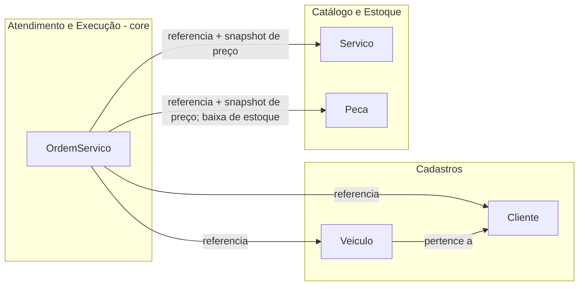
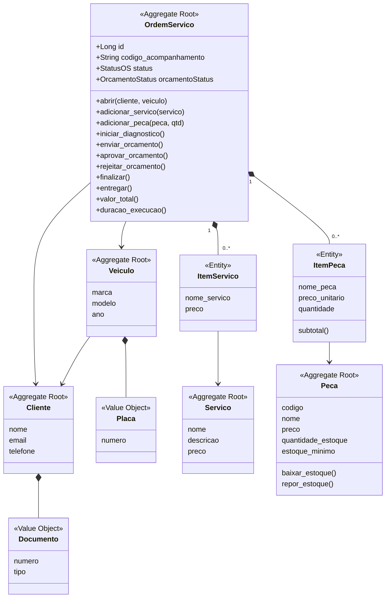
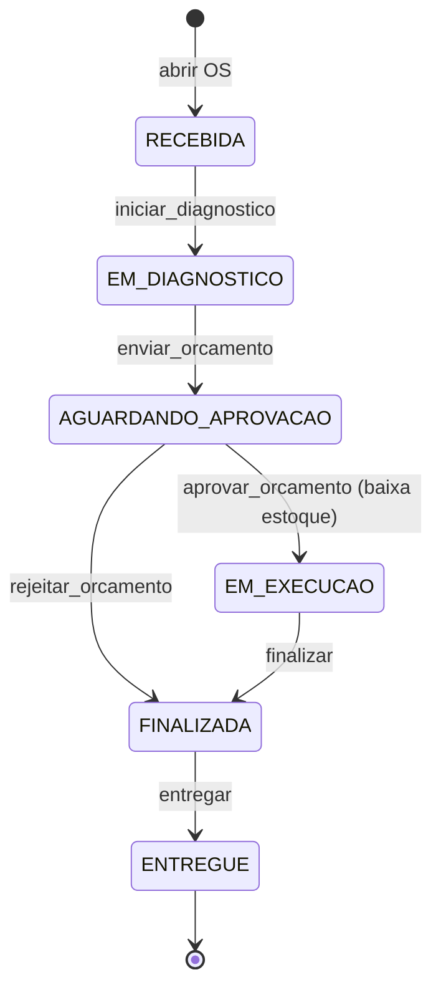
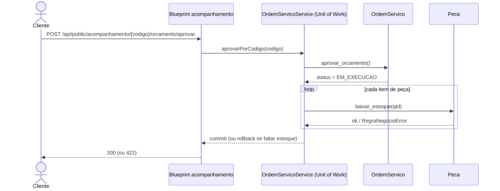

# Diagramas

## 1. Mapa de contextos

## 2. Modelo de domínio (agregados, entidades e objetos de valor)

## 3. Ciclo de vida da Ordem de Serviço

## 4. Sequência: aprovação do orçamento pelo cliente

