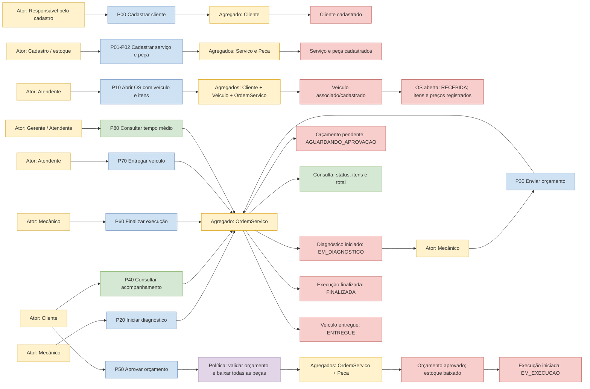

# Event Storming — caminho feliz da Ordem de Serviço

Modelo de board para reproduzir no Miro. O fluxo cobre a recepção do veículo até a entrega, incluindo os cadastros necessários como preparação. As notas descrevem eventos de domínio conceituais para o workshop; o MVP não publica eventos de domínio em um barramento.

## Legenda do board

Crie frames horizontais para **Preparação**, **Recepção**, **Diagnóstico e orçamento**, **Aprovação do cliente**, **Execução**, e **Entrega e métricas**. Ordene as notas da esquerda para a direita pelo número:

| Tipo de nota | Cor sugerida | Conteúdo |
|---|---|---|
| Ator | Amarelo | Quem inicia ou participa da ação |
| Comando | Azul | Intenção que solicita uma mudança |
| Evento de domínio | Laranja | Fato ocorrido, escrito no passado |
| Agregado | Amarelo-claro | Dono das regras e do estado alterado |
| Política / regra | Lilás | Condição ou reação que governa a sequência |
| Consulta | Verde | Leitura sem alteração de estado |

Conecte **Ator → Comando → Agregado → Evento**. Quando uma política iniciar uma ação seguinte, conecte **Evento → Política → Comando**. Os números `Pxx` indicam a ordem do caminho feliz; `Rxx` identifica regras citadas nas notas.

## Atores e limites do MVP

- **Atendente** — recebe o veículo, abre a OS e entrega o veículo.
- **Mecânico** — inicia o diagnóstico, envia o orçamento e finaliza a execução.
- **Cliente** — consulta o andamento e aprova o orçamento pelo código de acompanhamento.
- **Gerente** — consulta a métrica de tempo médio de execução.
- **Sistema da oficina** — aplica as regras, calcula o orçamento, baixa o estoque e registra datas.
- **Responsável pelo cadastro/estoque** — prepara clientes, serviços e peças antes do atendimento.

Atendente, mecânico e responsável pelo cadastro/estoque são papéis conceituais do processo. No MVP, as rotas administrativas exigem JWT, mas a aplicação não diferencia esses papéis: todos os usuários administrativos usam `ADMIN`. O cliente usa a API pública com o código UUID de acompanhamento, sem login.

## Pré-condições — preparação do atendimento

Estas ações podem ocorrer antes da chegada do veículo e não precisam ser repetidas para cada OS.

| Ordem | Ator | Comando (azul) | Agregado (amarelo-claro) | Evento (laranja) | Política / regra (lilás) |
|---|---|---|---|---|---|
| P00 | Responsável pelo cadastro | Cadastrar cliente | `Cliente` | Cliente cadastrado | R01, R02 |
| P01 | Responsável pelo cadastro/estoque | Cadastrar serviço | `Servico` | Serviço cadastrado | R03 |
| P02 | Responsável pelo cadastro/estoque | Cadastrar peça e informar saldo inicial | `Peca` | Peça cadastrada | R04 |

## Caminho feliz — sequência de notas

| Ordem | Ator | Comando (azul) | Agregado(s) (amarelo-claro) | Evento(s) (laranja) | Política / regra (lilás) |
|---|---|---|---|---|---|
| P10 | Atendente | Abrir OS com documento do cliente, dados do veículo e itens | `Cliente`, `Veiculo`, `OrdemServico` | Veículo associado ou cadastrado; OS aberta como `RECEBIDA`; serviços e peças incluídos | R05–R09 |
| P20 | Mecânico | Iniciar diagnóstico | `OrdemServico` | Diagnóstico iniciado; OS passou a `EM_DIAGNOSTICO` | R10 |
| P30 | Mecânico | Enviar orçamento | `OrdemServico` | Orçamento enviado e pendente; OS passou a `AGUARDANDO_APROVACAO` | R11–R13 |
| P40 | Cliente | Consultar acompanhamento | `OrdemServico` (leitura) | — Consulta retorna status, itens e total | R14 |
| P50 | Cliente | Aprovar orçamento pelo código de acompanhamento | `OrdemServico`, `Peca` | Orçamento aprovado; estoques baixados; execução iniciada; OS passou a `EM_EXECUCAO` | R15–R17 |
| P60 | Mecânico | Finalizar execução | `OrdemServico` | Execução finalizada; OS passou a `FINALIZADA` | R18 |
| P70 | Atendente | Entregar veículo | `OrdemServico` | Veículo entregue; OS passou a `ENTREGUE` | R19 |
| P80 | Gerente/Atendente | Consultar tempo médio de execução | `OrdemServico` (leitura) | — Métrica calculada a partir de execuções finalizadas | R20 |

### Fluxo visual de referência

## Cartões de políticas e regras

| ID | Nota lilás para o Miro |
|---|---|
| R01 | O cliente deve ser cadastrado antes da abertura da OS. CPF/CNPJ é validado e não pode ser duplicado. |
| R02 | O documento é normalizado/validado como CPF ou CNPJ; dados obrigatórios devem estar preenchidos. |
| R03 | Serviço precisa existir no catálogo; a OS conserva nome e preço vigentes no momento da inclusão. |
| R04 | Peça precisa existir no catálogo; código é único, preço e estoque inicial não podem ser negativos. |
| R05 | A OS identifica o cliente pelo CPF/CNPJ. Cliente não encontrado impede a abertura. |
| R06 | A placa precisa ser válida. Se o veículo já existir, deve pertencer ao mesmo cliente; caso contrário, impede a abertura. |
| R07 | A OS nasce em `RECEBIDA`, com código de acompanhamento UUID único e não previsível. |
| R08 | Itens de serviço e peça são registrados na própria OS com snapshots de nome/preço; quantidade de peça deve ser maior que zero. |
| R09 | Total do orçamento = soma dos preços congelados dos serviços + soma de preço unitário × quantidade das peças, com duas casas decimais. |
| R10 | Só é permitido iniciar diagnóstico a partir de `RECEBIDA`. |
| R11 | O orçamento só pode ser enviado a partir de `EM_DIAGNOSTICO`; deve haver ao menos um serviço ou uma peça. |
| R12 | Ao enviar, o orçamento fica `PENDENTE` e a OS passa para `AGUARDANDO_APROVACAO`. |
| R13 | Itens só podem ser alterados em `RECEBIDA` ou `EM_DIAGNOSTICO`; depois do envio do orçamento, a composição fica bloqueada. |
| R14 | A consulta pública usa o código de acompanhamento e não requer JWT; a resposta de acompanhamento não expõe os dados pessoais do cliente. |
| R15 | Aprovar/rejeitar exige OS em `AGUARDANDO_APROVACAO` e orçamento `PENDENTE`. |
| R16 | A aprovação inicia a execução e baixa a quantidade de cada peça na mesma transação; falta de saldo em qualquer peça cancela toda a aprovação e mantém os saldos/status anteriores. |
| R17 | A baixa exige quantidade positiva e saldo suficiente. Concorrência de atualização de peça é protegida por versão otimista. |
| R18 | Só é possível finalizar a OS em `EM_EXECUCAO`; a data de início é registrada na aprovação e a data de fim na finalização. |
| R19 | Só é possível entregar uma OS `FINALIZADA`. A rejeição do orçamento encerra a OS sem execução e não baixa estoque. |
| R20 | A métrica considera OS com início e fim de execução registrados; OS rejeitadas não entram no cálculo. |

## Agregados a destacar no board

- **`OrdemServico` (raiz)** — controla status, orçamento, código de acompanhamento, datas e itens. `ItemServico` e `ItemPeca` são entidades internas; os snapshots preservam nome/preço usados na OS.
- **`Cliente`** — cadastro e documento; a OS mantém referência ao cliente.
- **`Veiculo`** — placa e dados do veículo; pertence a um cliente e é reutilizado se já estiver cadastrado para esse cliente.
- **`Servico`** — item do catálogo consultado ao abrir a OS.
- **`Peca`** — catálogo e saldo de estoque; é atualizado durante a aprovação da OS.

No P50, desenhe uma borda de transação ao redor do comando de aprovação e da atualização de `OrdemServico` + `Peca`: a aplicação coordena as duas alterações atomicamente no MVP. Não represente `ItemServico` ou `ItemPeca` como agregados independentes.

## Ações de leitura e endpoints para anotações secundárias

Esses dados podem ser colocados em cartões pequenos junto das notas, sem interromper a linha do tempo:

| Ordem | Endpoint de referência |
|---|---|
| P00–P02 | `POST /api/admin/clientes`, `POST /api/admin/servicos`, `POST /api/admin/pecas` |
| P10 | `POST /api/admin/ordens-servico` |
| P20–P30 | `POST /api/admin/ordens-servico/{id}/diagnostico`, `POST /api/admin/ordens-servico/{id}/orcamento/enviar` |
| P40–P50 | `GET /api/public/acompanhamento/{codigo}`, `POST /api/public/acompanhamento/{codigo}/orcamento/aprovar` |
| P60–P70 | `POST /api/admin/ordens-servico/{id}/finalizar`, `POST /api/admin/ordens-servico/{id}/entregar` |
| P80 | `GET /api/admin/metricas/tempo-medio-execucao` |

## Fora do caminho feliz

Não adicione ao fluxo principal pagamento, emissão de nota fiscal, agendamento, reserva de estoque ou notificação automática: esses comportamentos não estão implementados neste MVP. A falta de estoque durante a aprovação e a rejeição do orçamento são desvios úteis para uma sessão posterior, mas não fazem parte deste caminho feliz.
