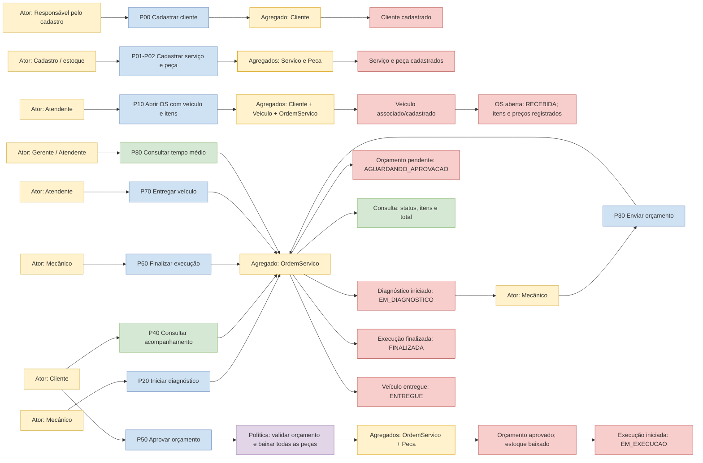
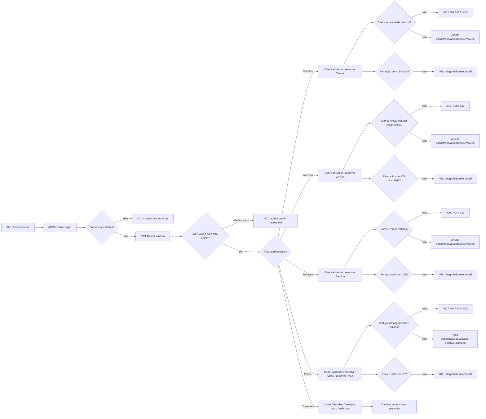
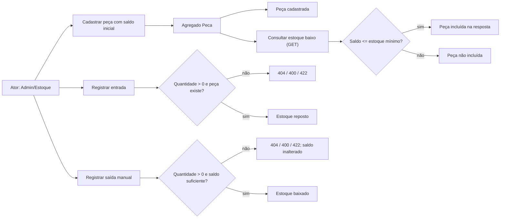

# Event Storming — fluxos completos da oficina

Modelo de board para reproduzir no Miro, cobrindo os fluxos de negócio implementados no MVP: autenticação administrativa, cadastros, catálogo, estoque, ciclo da OS, acompanhamento do cliente, consultas e caminhos de erro/alternativos. Os eventos nas notas são fatos de domínio conceituais para o workshop; o MVP não publica eventos em um barramento.

## Legenda do board

Crie frames horizontais para **Acesso**, **Cadastros**, **Catálogo e estoque**, **Recepção**, **Diagnóstico e orçamento**, **Decisão do cliente**, **Execução e entrega**, **Consultas** e **Erros/atenções**. Ordene as notas da esquerda para a direita pelo número:

| Tipo de nota | Cor sugerida | Conteúdo |
|---|---|---|
| Ator | Amarelo | Quem inicia ou participa da ação |
| Comando | Azul | Intenção que solicita uma mudança |
| Evento de domínio | Laranja | Fato ocorrido, escrito no passado |
| Agregado | Amarelo-claro | Dono das regras e do estado alterado |
| Política / regra | Lilás | Condição ou reação que governa a sequência |
| Consulta | Verde | Leitura sem alteração de estado |

Conecte **Ator → Comando → Agregado → Evento**. Quando uma política iniciar uma ação seguinte, conecte **Evento → Política → Comando**. Os números `Pxx` indicam a linha principal; `Rxx` identifica cartões de regra/política; `Dxx` identifica decisões e desvios; `ATxx` identifica pontos de atenção. Use losangos para decisões com ramos `sim/não` e cartões vermelhos para falhas/alertas.

## Atores e limites do MVP

- **Atendente** — recebe o veículo, abre a OS e entrega o veículo.
- **Mecânico** — inicia o diagnóstico, envia o orçamento e finaliza a execução.
- **Cliente** — consulta o andamento e aprova o orçamento pelo código de acompanhamento.
- **Gerente** — consulta a métrica de tempo médio de execução.
- **Sistema da oficina** — aplica as regras, calcula o orçamento, baixa o estoque e registra datas.
- **Responsável pelo cadastro/estoque** — prepara clientes, serviços e peças antes do atendimento.

Atendente, mecânico e responsável pelo cadastro/estoque são papéis conceituais do processo. No MVP, as rotas administrativas exigem JWT, mas a aplicação não diferencia esses papéis: todos os usuários administrativos usam `ADMIN`. O cliente usa a API pública com o código UUID de acompanhamento, sem login.

## Pré-condições — preparação do atendimento

Estas ações podem ocorrer antes da chegada do veículo e não precisam ser repetidas para cada OS.

| Ordem | Ator | Comando (azul) | Agregado (amarelo-claro) | Evento (laranja) | Política / regra (lilás) |
|---|---|---|---|---|---|
| P00 | Responsável pelo cadastro | Cadastrar cliente | `Cliente` | Cliente cadastrado | R01, R02 |
| P01 | Responsável pelo cadastro/estoque | Cadastrar serviço | `Servico` | Serviço cadastrado | R03 |
| P02 | Responsável pelo cadastro/estoque | Cadastrar peça e informar saldo inicial | `Peca` | Peça cadastrada | R04 |

## Linha principal da Ordem de Serviço

Esta linha resume a sequência de maior sucesso. As alternativas, os cadastros administrativos e as falhas estão modelados nas seções seguintes.

| Ordem | Ator | Comando (azul) | Agregado(s) (amarelo-claro) | Evento(s) (laranja) | Política / regra (lilás) |
|---|---|---|---|---|---|
| P10 | Atendente | Abrir OS com documento do cliente, dados do veículo e itens | `Cliente`, `Veiculo`, `OrdemServico` | Veículo associado ou cadastrado; OS aberta como `RECEBIDA`; serviços e peças incluídos | R05–R09 |
| P20 | Mecânico | Iniciar diagnóstico | `OrdemServico` | Diagnóstico iniciado; OS passou a `EM_DIAGNOSTICO` | R10 |
| P30 | Mecânico | Enviar orçamento | `OrdemServico` | Orçamento enviado e pendente; OS passou a `AGUARDANDO_APROVACAO` | R11–R13 |
| P40 | Cliente | Consultar acompanhamento | `OrdemServico` (leitura) | — Consulta retorna status, itens e total | R14 |
| P50 | Cliente | Aprovar orçamento pelo código de acompanhamento | `OrdemServico`, `Peca` | Orçamento aprovado; estoques baixados; execução iniciada; OS passou a `EM_EXECUCAO` | R15–R17 |
| P60 | Mecânico | Finalizar execução | `OrdemServico` | Execução finalizada; OS passou a `FINALIZADA` | R18 |
| P70 | Atendente | Entregar veículo | `OrdemServico` | Veículo entregue; OS passou a `ENTREGUE` | R19 |
| P80 | Gerente/Atendente | Consultar tempo médio de execução | `OrdemServico` (leitura) | — Métrica calculada a partir de execuções finalizadas | R20 |

### Fluxo visual de referência

## Cartões de políticas e regras

| ID | Nota lilás para o Miro |
|---|---|
| R01 | O cliente deve ser cadastrado antes da abertura da OS. CPF/CNPJ é validado e não pode ser duplicado. |
| R02 | O documento é normalizado/validado como CPF ou CNPJ; dados obrigatórios devem estar preenchidos. |
| R03 | Serviço precisa existir no catálogo; a OS conserva nome e preço vigentes no momento da inclusão. |
| R04 | Peça precisa existir no catálogo; código é único, preço e estoque inicial não podem ser negativos. |
| R05 | A OS identifica o cliente pelo CPF/CNPJ. Cliente não encontrado impede a abertura. |
| R06 | A placa precisa ser válida. Se o veículo já existir, deve pertencer ao mesmo cliente; caso contrário, impede a abertura. |
| R07 | A OS nasce em `RECEBIDA`, com código de acompanhamento UUID único e não previsível. |
| R08 | Itens de serviço e peça são registrados na própria OS com snapshots de nome/preço; quantidade de peça deve ser maior que zero. |
| R09 | Total do orçamento = soma dos preços congelados dos serviços + soma de preço unitário × quantidade das peças, com duas casas decimais. |
| R10 | Só é permitido iniciar diagnóstico a partir de `RECEBIDA`. |
| R11 | O orçamento só pode ser enviado a partir de `EM_DIAGNOSTICO`; deve haver ao menos um serviço ou uma peça. |
| R12 | Ao enviar, o orçamento fica `PENDENTE` e a OS passa para `AGUARDANDO_APROVACAO`. |
| R13 | Itens só podem ser alterados em `RECEBIDA` ou `EM_DIAGNOSTICO`; depois do envio do orçamento, a composição fica bloqueada. |
| R14 | A consulta pública usa o código de acompanhamento e não requer JWT; a resposta de acompanhamento não expõe os dados pessoais do cliente. |
| R15 | Aprovar/rejeitar exige OS em `AGUARDANDO_APROVACAO` e orçamento `PENDENTE`. |
| R16 | A aprovação inicia a execução e baixa a quantidade de cada peça na mesma transação; falta de saldo em qualquer peça cancela toda a aprovação e mantém os saldos/status anteriores. |
| R17 | A baixa exige quantidade positiva e saldo suficiente. Concorrência de atualização de peça é protegida por versão otimista. |
| R18 | Só é possível finalizar a OS em `EM_EXECUCAO`; a data de início é registrada na aprovação e a data de fim na finalização. |
| R19 | Só é possível entregar uma OS `FINALIZADA`. A rejeição do orçamento encerra a OS sem execução e não baixa estoque. |
| R20 | A métrica considera OS com início e fim de execução registrados; OS rejeitadas não entram no cálculo. |

## Agregados a destacar no board

- **`OrdemServico` (raiz)** — controla status, orçamento, código de acompanhamento, datas e itens. `ItemServico` e `ItemPeca` são entidades internas; os snapshots preservam nome/preço usados na OS.
- **`Cliente`** — cadastro e documento; a OS mantém referência ao cliente.
- **`Veiculo`** — placa e dados do veículo; pertence a um cliente e é reutilizado se já estiver cadastrado para esse cliente.
- **`Servico`** — item do catálogo consultado ao abrir a OS.
- **`Peca`** — catálogo e saldo de estoque; é atualizado durante a aprovação da OS.

No P50, desenhe uma borda de transação ao redor do comando de aprovação e da atualização de `OrdemServico` + `Peca`: a aplicação coordena as duas alterações atomicamente no MVP. Não represente `ItemServico` ou `ItemPeca` como agregados independentes.

## Ações de leitura e endpoints para anotações secundárias

Esses dados podem ser colocados em cartões pequenos junto das notas, sem interromper a linha do tempo:

| Ordem | Endpoint de referência |
|---|---|
| P00–P02 | `POST /api/admin/clientes`, `POST /api/admin/servicos`, `POST /api/admin/pecas` |
| P10 | `POST /api/admin/ordens-servico` |
| P20–P30 | `POST /api/admin/ordens-servico/{id}/diagnostico`, `POST /api/admin/ordens-servico/{id}/orcamento/enviar` |
| P40–P50 | `GET /api/public/acompanhamento/{codigo}`, `POST /api/public/acompanhamento/{codigo}/orcamento/aprovar` |
| P60–P70 | `POST /api/admin/ordens-servico/{id}/finalizar`, `POST /api/admin/ordens-servico/{id}/entregar` |
| P80 | `GET /api/admin/metricas/tempo-medio-execucao` |

## Fora do escopo implementado

Pagamento, emissão de nota fiscal, agendamento, cancelamento/reabertura de OS, reserva de estoque, remoção/edição de itens individuais e notificação automática não estão implementados neste MVP. Não os represente como comandos ou eventos existentes.

## Mapa completo de decisões e caminhos da OS

Use este diagrama como o frame principal do board. Cada losango é uma decisão/política e cada saída negativa deve terminar em um cartão de atenção/erro, sem evento de sucesso.

```mermaid
flowchart LR
  A["Atendente"] --> C0["D01 Abrir OS"]
  C0 --> D1{"Cliente cadastrado?"}
  D1 -- "não" --> E404["Erro: cliente não encontrado"]
  D1 -- "sim" --> D2{"Documento válido?"}
  D2 -- "não" --> E422["Erro: regra de domínio"]
  D2 -- "sim" --> D3{"Veículo com esta placa existe?"}
  D3 -- "não" --> C1["Cadastrar veículo na abertura"]
  C1 --> Gv["Agregado Veiculo"]
  D3 -- "sim" --> D4{"É do mesmo cliente?"}
  D4 -- "não" --> Eowner["Erro: placa pertence a outro cliente"]
  D4 -- "sim" --> Gv
  Gv --> C2["Criar OS e incluir itens informados"]
  C2 --> D5{"IDs de serviço/peça existem e quantidades são válidas?"}
  D5 -- "não" --> Eitem["Erro: item inválido/não encontrado"]
  D5 -- "sim" --> Gos["Agregado OrdemServico"]
  Gos --> Eopen["OS aberta: RECEBIDA; código de acompanhamento criado"]
  Eopen --> D6{"Itens já incluídos?"}
  D6 -- "não" --> Cadd["Adicionar itens (opcional)"]
  Cadd --> D6
  D6 -- "sim" --> Cdiag["Iniciar diagnóstico"]
  Cdiag --> D7{"Status = RECEBIDA?"}
  D7 -- "não" --> Estate1["Erro 422: transição inválida"]
  D7 -- "sim" --> Ediag["Diagnóstico iniciado: EM_DIAGNOSTICO"]
  Ediag --> D8{"Há ao menos um item?"}
  D8 -- "não" --> Eempty["Erro 422: orçamento sem itens; incluir item e tentar novamente"]
  Eempty --> Cadd
  D8 -- "sim" --> Cquote["Enviar orçamento"]
  Cquote --> Equote["Orçamento PENDENTE; OS AGUARDANDO_APROVACAO"]
  Equote --> Qtrack["Cliente consulta por código (opcional/repetível)"]
  Qtrack --> D9{"Código encontrado?"}
  D9 -- "não" --> E404track["Erro 404: código inexistente"]
  D9 -- "sim" --> Choice{"Decisão do cliente"}
  Choice -- "aprovar" --> D10{"Orçamento pendente?"}
  D10 -- "não" --> Estate2["Erro 422: decisão fora de estado"]
  D10 -- "sim" --> D11{"Saldo suficiente para todas as peças?"}
  D11 -- "não" --> Erollback["Erro 422: estoque insuficiente; rollback total"]
  Erollback -. "corrigir/repor saldo; aprovação pode ser tentada novamente" .-> Capprove["Aprovar orçamento"]
  D11 -- "sim" --> Capprove
  Capprove --> Gstock["Agregados: OrdemServico + Peca"]
  Gstock --> Eapproved["Orçamento aprovado; estoque baixado"]
  Eapproved --> Eexec["Execução iniciada: EM_EXECUCAO"]
  Eexec --> Cfinish["Finalizar execução"]
  Cfinish --> D12{"Status = EM_EXECUCAO?"}
  D12 -- "não" --> Estate3["Erro 422: transição inválida"]
  D12 -- "sim" --> Efinish["Execução finalizada: FINALIZADA"]
  Choice -- "rejeitar" --> Creject["Rejeitar orçamento"]
  Creject --> D13{"Orçamento pendente?"}
  D13 -- "não" --> Estate4["Erro 422: decisão fora de estado"]
  D13 -- "sim" --> Ereject["Orçamento REJEITADO; OS FINALIZADA sem execução"]
  Efinish --> Cdeliver["Entregar veículo"]
  Ereject --> Cdeliver
  Cdeliver --> D14{"Status = FINALIZADA?"}
  D14 -- "não" --> Estate5["Erro 422: transição inválida"]
  D14 -- "sim" --> Edelivered["OS ENTREGUE"]
```

### Caminhos de estado que devem aparecer como cartões

| ID | Caminho / ramo | Resultado |
|---|---|---|
| D01 | Cliente não existe | A abertura é bloqueada; cadastrar cliente e reiniciar a abertura. |
| D02 | Placa ainda não cadastrada | Veículo é criado durante a abertura, ligado ao cliente informado. |
| D03 | Veículo existe para outro cliente | A abertura é bloqueada; não transfere o veículo automaticamente. |
| D04 | OS aberta sem itens | Permitido; adicionar itens enquanto `RECEBIDA`/`EM_DIAGNOSTICO`. Não é possível enviar orçamento vazio. |
| D05 | Serviço ou peça não encontrado, ou quantidade inválida | Operação falha; nenhum sucesso é registrado. |
| D06 | Diagnóstico iniciado / adição de itens | Adição de itens pode ocorrer em `RECEBIDA` ou `EM_DIAGNOSTICO`; demais estados rejeitam a alteração. |
| D07 | Aprovação com saldo suficiente | Orçamento aprovado, baixa de todas as peças e início da execução na mesma transação. |
| D08 | Aprovação com saldo insuficiente ou conflito de concorrência | Aprovação e baixas são revertidas; o orçamento continua pendente e o estoque permanece inalterado. |
| D09 | Rejeição do orçamento | OS termina em `FINALIZADA`, sem execução, sem datas de execução e sem baixa de estoque; pode seguir para entrega. |
| D10 | Tentativa de comando no estado errado | Transição recusada; não há avanço de estado. |
| D11 | Entrega | Permitida para `FINALIZADA`, tanto após execução quanto após rejeição. |

O caminho de estados é `RECEBIDA → EM_DIAGNOSTICO → AGUARDANDO_APROVACAO → (EM_EXECUCAO →) FINALIZADA → ENTREGUE`. O ramo de rejeição vai de `AGUARDANDO_APROVACAO` diretamente para `FINALIZADA`. `ENTREGUE` é terminal. O estado do orçamento percorre `NAO_GERADO → PENDENTE → APROVADO` ou `REJEITADO`.

No cartão de aprovação/rejeição, mostre os dois canais equivalentes: Cliente pela API pública com código e Admin/Atendente pelo endpoint administrativo usando ID da OS. A regra de domínio e os resultados são os mesmos.

## Fluxos administrativos e de catálogo

Use os cartões abaixo em frames separados, todos sob o ator administrativo autenticado. `Listar` e `Detalhar` são cartões verdes de consulta; criar/atualizar/remover são comandos azuis. Os eventos são nomes conceituais para o board.

| ID | Ator | Comando / consulta | Agregado | Evento de sucesso | Desvios |
|---|---|---|---|---|---|
| CAD01 | Admin/Atendente | Cadastrar cliente | `Cliente` | Cliente cadastrado | CPF/CNPJ inválido → 422; documento duplicado → 409; payload inválido → 400 |
| CAD02 | Admin/Atendente | Consultar lista/detalhe de clientes | `Cliente` | — | ID inexistente → 404 |
| CAD03 | Admin/Atendente | Atualizar cliente | `Cliente` | Cliente atualizado | ID ausente → 404; documento já usado por outro cliente → 409; dados inválidos → 400/422 |
| CAD04 | Admin/Atendente | Remover cliente | `Cliente` | Cliente removido | Cliente inexistente → 404; vínculos com veículo/OS → 409 |
| CAD05 | Admin/Atendente | Cadastrar veículo | `Veiculo`, `Cliente` | Veículo cadastrado | Cliente inexistente → 404; placa inválida/regra de domínio → 422; placa duplicada → 409 |
| CAD06 | Admin/Atendente | Listar veículos (opcional `clienteId`) / detalhar | `Veiculo` | — | Detalhe de ID inexistente → 404 |
| CAD07 | Admin/Atendente | Atualizar veículo | `Veiculo`, `Cliente` | Veículo atualizado | Veículo/cliente inexistente → 404; placa duplicada → 409; dados/placa inválidos → 400/422 |
| CAD08 | Admin/Atendente | Remover veículo | `Veiculo` | Veículo removido | Veículo inexistente → 404; vínculo com OS pode impedir remoção → 409 |
| CAT01 | Admin/Estoque | Cadastrar serviço | `Servico` | Serviço cadastrado | Nome/preço inválido → 400/422 |
| CAT02 | Admin/Estoque | Consultar lista/detalhe de serviços | `Servico` | — | ID inexistente → 404 |
| CAT03 | Admin/Estoque | Atualizar serviço | `Servico` | Serviço atualizado | ID inexistente → 404; nome/preço inválido → 400/422 |
| CAT04 | Admin/Estoque | Remover serviço | `Servico` | Serviço removido | ID inexistente → 404; serviço referenciado em OS pode impedir remoção → 409 |
| EST01 | Admin/Estoque | Cadastrar peça com saldo inicial e estoque mínimo | `Peca` | Peça cadastrada | Código duplicado → 409; preço/saldos inválidos → 400/422 |
| EST02 | Admin/Estoque | Consultar lista/detalhe de peças | `Peca` | — | ID inexistente → 404 |
| EST03 | Admin/Estoque | Atualizar cadastro/corrigir saldo | `Peca` | Peça atualizada | Código duplicado → 409; dados inválidos → 400/422; concorrência pode resultar em 409 |
| EST04 | Admin/Estoque | Registrar entrada de estoque | `Peca` | Estoque reposto | Peça inexistente → 404; quantidade não positiva → 400/422 |
| EST05 | Admin/Estoque | Registrar saída manual | `Peca` | Estoque baixado | Peça inexistente → 404; quantidade inválida/maior que saldo → 400/422 |
| EST06 | Admin/Estoque | Consultar estoque baixo | `Peca` (leitura) | — | Retorna peças com quantidade menor ou igual ao mínimo; não dispara reposição automática |
| EST07 | Admin/Estoque | Remover peça | `Peca` | Peça removida | ID inexistente → 404; referência em OS pode impedir remoção → 409 |

### Representação visual — acesso, cadastros e estoque

## Acesso, consultas e tratamento de falhas

### Cartões de acesso

| ID | Ator | Comando / evento ou decisão | Regra |
|---|---|---|---|
| ACC01 | Administrador | Fazer login (`POST /api/auth/login`) | Credenciais válidas → JWT Bearer emitido; inválidas → 401. |
| ACC02 | Admin | Acessar `/api/admin/**` | Exige token JWT válido; rotas administrativas usam o papel `ADMIN` no MVP. |
| ACC03 | Cliente | Consultar/aprovar/rejeitar por código | `/api/public/acompanhamento/**` é público; o UUID funciona como credencial de acesso à OS, sem login. |
| ACC04 | Usuário | Acessar Swagger / OpenAPI | Documentação é pública. Outras rotas não liberadas são negadas. |

### Cartões verdes de leitura

| ID | Consulta | Resultado / regra |
|---|---|---|
| Q01 | Listar OS; filtrar opcionalmente por status | Ordena por chegada; filtro é por estado atual. |
| Q02 | Detalhar OS por ID | Retorna itens, orçamento, estado e datas; não altera a OS. |
| Q03 | Acompanhar OS por código | Retorna status, veículo, itens, total e datas; código inexistente → 404; não retorna dados pessoais do cliente. |
| Q04 | Consultar estoque baixo | Saldo `<= estoqueMinimo`; é consulta, não evento automático. |
| Q05 | Consultar tempo médio de execução | Média entre aprovação/início e finalização para OS com ambas as datas; sem dados, retorna quantidade zero, média zero e `"sem dados"`. |
| Q06 | Listar/detalhar cadastros | Clientes, veículos, serviços e peças têm consultas administrativas; veículo pode ser filtrado por cliente. |

### Cartão comum de resultado de erro

| ID | Resultado | Quando usar no board |
|---|---|---|
| ERR01 | `400 Bad Request` | Payload que falha validação de campos (`@Valid`). |
| ERR02 | `401 Unauthorized` | Sem JWT, token inválido/expirado ou credenciais de login inválidas. |
| ERR03 | `404 Not Found` | ID de cadastro/OS ou código de acompanhamento não localizado. |
| ERR04 | `409 Conflict` | Documento/placa/código duplicado, registro em uso por referência ou conflito de concorrência/versão otimista. |
| ERR05 | `422 Unprocessable Entity` | Regra de domínio: estado inválido, saldo insuficiente, quantidade inválida ou CPF/CNPJ/placa inválidos. |

Associe cada erro ao comando que falhou e não conecte erro a evento de sucesso. As respostas de erro são tratadas pelo `GlobalExceptionHandler`; o caminho do fluxo deve permanecer no estado anterior quando a transação falhar.

## Cartões de políticas e regras adicionais

| ID | Nota lilás para o Miro |
|---|---|
| R21 | Todas as rotas administrativas exigem JWT; login, acompanhamento público, Swagger/OpenAPI são exceções públicas configuradas. |
| R22 | Cliente: nome e documento obrigatórios; CPF/CNPJ válido e normalizado; documento não pode pertencer a outro cliente. |
| R23 | Veículo: placa normalizada/válida, marca/modelo obrigatórios, ano validado e cliente existente; placa é única. |
| R24 | Serviço: nome obrigatório e preço não negativo; o sistema não impõe unicidade de nome. |
| R25 | Peça: código obrigatório e normalizado em maiúsculas, código único, preço e estoque mínimo/saldo não negativos. |
| R26 | Entrada e saída manual de estoque exigem quantidade positiva; saída não pode exceder o saldo. |
| R27 | Estoque baixo significa `quantidadeEstoque <= estoqueMinimo`; o sistema apenas oferece consulta, sem alerta/notificação automática. |
| R28 | A baixa de estoque da aprovação usa versão otimista; conflito exige reavaliar o estado e não deve ser tratado como aprovação concluída. |
| R29 | Alteração de preço/nome no catálogo não altera snapshots já armazenados nos itens de OS existentes. |
| R30 | A composição da OS não possui comando para remover/editar item individual; o endpoint existente apenas adiciona itens em estados permitidos. |
| R31 | Exclusões de cadastros referenciados podem falhar por integridade referencial e retornam conflito; não apagar cascata de OS/itens. |
| R32 | Uma OS rejeitada não possui `inicioExecucaoEm`/`fimExecucaoEm`; fica fora da métrica de execução apesar de estar `FINALIZADA`. |
| R33 | A API pública permite decisão por código de acompanhamento; trate o código como segredo e não o exponha em canais não autorizados. |

## Cartões de ponto de atenção

| ID | Nota vermelha / laranja para o Miro |
|---|---|
| AT01 | **Evento Storming conceitual:** o código persiste estado e não publica eventos de domínio. Não desenhar broker, consumidores ou notificações como se existissem. |
| AT02 | **Papéis simplificados:** Atendente, Mecânico, Estoquista e Gerente são papéis de negócio; o MVP não os autentica separadamente. |
| AT03 | **Sem reserva de estoque:** saldo só é baixado na aprovação; o orçamento enviado não garante disponibilidade posterior. |
| AT04 | **Atomicidade da aprovação:** OS + baixa de todas as peças precisam ser tratados como uma transação; falha em qualquer peça reverte tudo. |
| AT05 | **Rejeição não é cancelamento:** rejeitar define orçamento `REJEITADO` e OS `FINALIZADA`; não há comando de cancelar/reabrir. |
| AT06 | **Finalizada tem dois significados de negócio:** execução concluída ou orçamento rejeitado; use `orcamentoStatus`/datas para distinguir na leitura. |
| AT07 | **Sem cobrança:** aprovação do orçamento não registra pagamento, faturamento ou nota fiscal. |
| AT08 | **Sem comunicação automática:** “enviar orçamento” muda o estado para pendente; não há integração implementada para e-mail/SMS/WhatsApp. |
| AT09 | **Itens e preços congelados:** o total usa snapshot do item, não o preço atualizado no catálogo. |
| AT10 | **Consultas não são eventos:** listar, detalhar, consultar acompanhamento, estoque baixo e métrica são cartões verdes sem mutação. |
| AT11 | **Sem idempotência explícita de comandos:** uma repetição pode falhar por estado atual (ex.: aprovar orçamento já aprovado). |
| AT12 | **Exclusão referenciada:** mostrar o ramo de conflito de integridade em vez de assumir exclusão em cascata. |
| AT13 | **Abertura e adição são atômicas por requisição:** item inexistente ou inválido deve impedir a operação completa, não deixar uma OS parcial. |

## Endpoints para cartões pequenos de referência

| Área | Rotas |
|---|---|
| Autenticação | `POST /api/auth/login` |
| Clientes | `/api/admin/clientes` — `POST`, `GET`, `GET /{id}`, `PUT /{id}`, `DELETE /{id}` |
| Veículos | `/api/admin/veiculos` — `POST`, `GET` (filtro `clienteId`), `GET /{id}`, `PUT /{id}`, `DELETE /{id}` |
| Serviços | `/api/admin/servicos` — `POST`, `GET`, `GET /{id}`, `PUT /{id}`, `DELETE /{id}` |
| Peças | `/api/admin/pecas` — `POST`, `GET`, `GET /{id}`, `PUT /{id}`, `DELETE /{id}`, `GET /estoque-baixo`, `POST /{id}/estoque/entrada`, `POST /{id}/estoque/saida` |
| OS | `/api/admin/ordens-servico` — `POST`, `GET` (filtro `status`), `GET /{id}`, `POST /{id}/itens`, `/diagnostico`, `/orcamento/enviar`, `/orcamento/aprovar`, `/orcamento/rejeitar`, `/finalizar`, `/entregar` |
| Acompanhamento | `/api/public/acompanhamento/{codigo}` — `GET`, `POST /orcamento/aprovar`, `POST /orcamento/rejeitar` |
| Métricas | `GET /api/admin/metricas/tempo-medio-execucao` |
| Documentação | `/swagger-ui/**`, `/v3/api-docs/**` |

## Agregados e consistência

- **`OrdemServico` (raiz)** — status, status do orçamento, código, datas e itens (`ItemServico`/`ItemPeca` como entidades internas).
- **`Cliente`**, **`Veiculo`**, **`Servico`** e **`Peca`** — agregados/cadastros referenciados pela OS.
- **Aprovação** — o serviço de aplicação coordena `OrdemServico` e `Peca` na mesma transação. Desenhe uma borda de consistência no comando; não desenhe a OS como raiz do estoque.
- **Leituras** — métricas e consultas usam os estados persistidos; não são agregados separados nem eventos.
